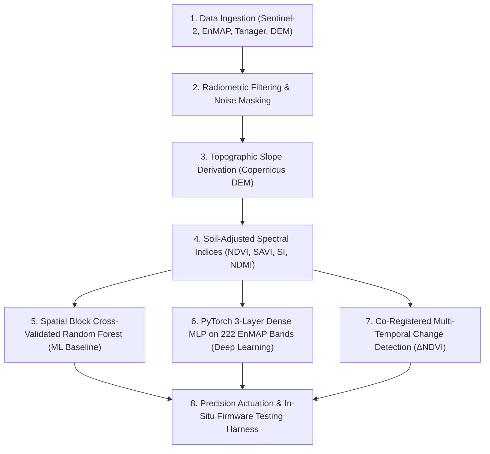
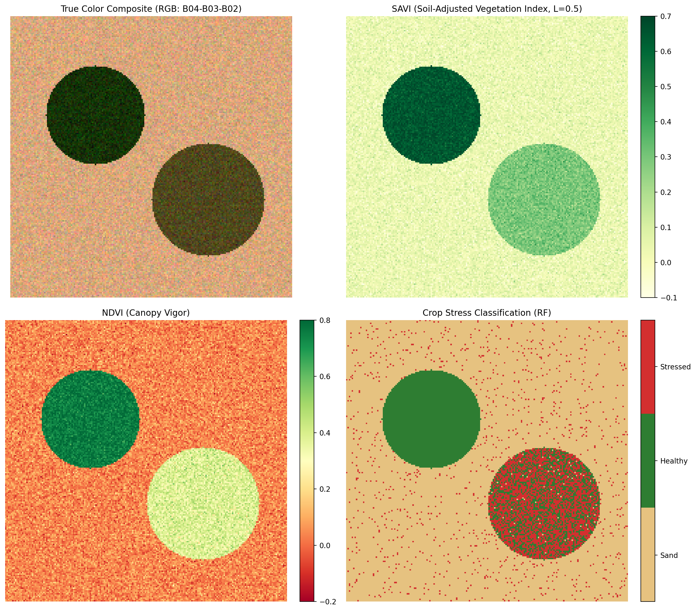
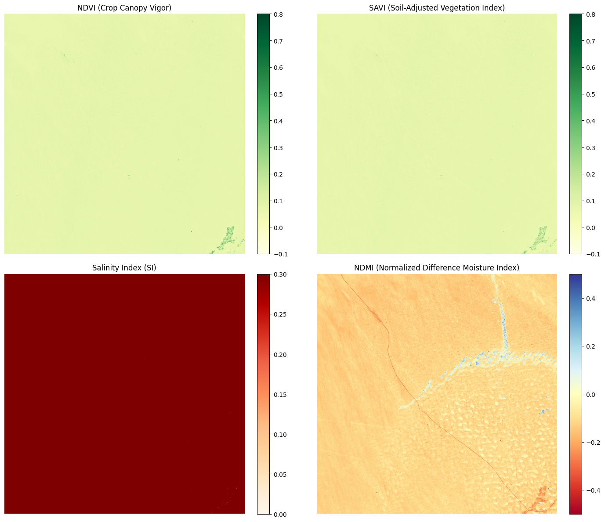
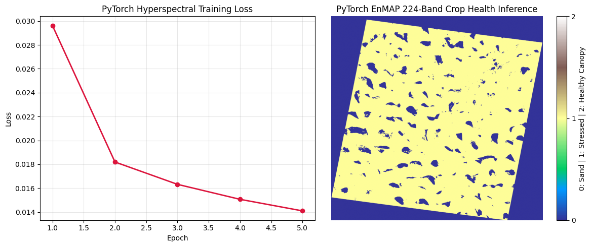
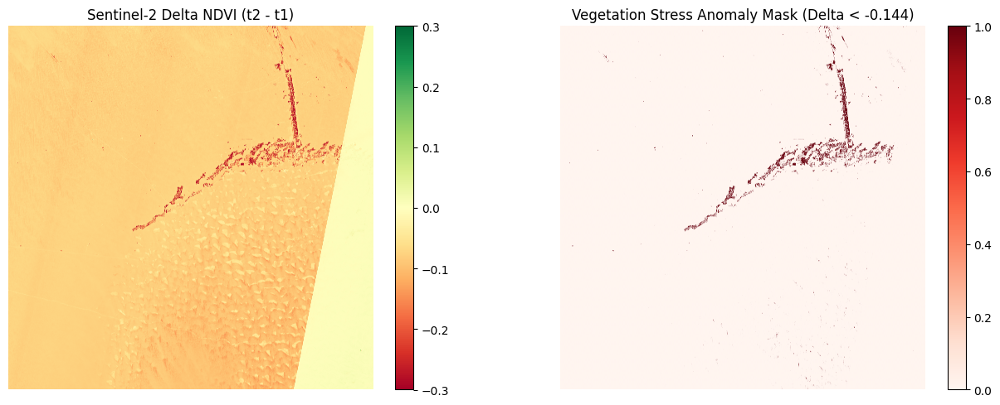

# Liwa Precision Agriculture — Arab Youth Space Hackathon 2026

**Project:** Autonomous Crop Health, Soil Salinity & Smart Irrigation Intelligence  
**Team:** Green Liwa (ليوا الخضراء)  
**Theme:** Precision Agriculture & Crop Intelligence  
**Track:** Challenge 813 — Proof of Concept (PoC) Submission  
**Country:** United Arab Emirates (UAE)  
**Deadline:** 11 October 2026, 23:59  

---

## 1. Title and One-Line Summary

**Green Liwa: Precision Agriculture and Crop Intelligence in Liwa Oasis**  
An end-to-end Earth Observation and IoT intelligence pipeline fusing multi-temporal Sentinel-2 and continuous 224-band EnMAP hyperspectral imagery to detect crop water stress, soil salinization, and canopy phenology in Liwa Oasis, routing localized automated drip irrigation in desert reclamation zones.

---

## 2. The Business Use Case

### Target End-User
Commercial date palm farm managers, cooperative agronomists, and private estate owners operating across the agricultural pockets of Liwa Oasis, Al Dhafra Region, Abu Dhabi; regulated and monitored by the **Abu Dhabi Agriculture and Food Safety Authority (ADAFSA)**.

### Operational Decision Made
Farm operators use this solution to identify the exact agricultural parcels suffering from acute root-zone moisture deficit versus progressive soil salinization. This enables them to:
1. Dynamically prioritize field inspections rather than scouting hundreds of hectares blindly.
2. Trigger localized, variable-rate drip irrigation and salt-leaching flushes only where required.
3. Prevent irreversible date palm canopy necrosis and preserve high-value date yields.

### Current Methods Used Today
Current industry practice relies almost exclusively on:
- **Trial-and-error visual scouting:** Manual driving across difficult dune tracks, identifying stress only after severe foliage yellowing or wilting is already underway.
- **Delayed soil testing:** Periodic physical soil sampling sent to remote laboratories, taking days to weeks for Electrical Conductivity (EC) results.
- **Uniform schedule-based flood or un-zoned drip irrigation:** Indiscriminate pumping of brackish groundwater on rigid timers, losing 30% to 50% of water to evaporation while accelerating root-zone salt crust formation.

---

## 3. The Problem

### Critical Challenges & Scale
The United Arab Emirates possesses only **0.5%–0.7%** arable land (~400–600 km²), relying on international imports for over 80% of national food supply. In the Liwa Oasis (hyper-arid Rub' al Khali desert), agriculture faces three compounding structural barriers:
1. **Severe Groundwater Depletion & Salinization:** Zero permanent freshwater infrastructure exists; farming relies on ancient non-renewable fossil aquifers. Pumping creates localized cones of depression that draw in hyper-saline groundwater ($EC > 12\text{ dS/m}$), forming toxic gypsum and halite crusts in root zones.
2. **Extreme Atmospheric Evaporative Demand:** Daytime temperatures exceeding 45°C drive intense potential evapotranspiration, causing standard flood irrigation to waste 30%–50% of applied water.
3. **Severe Spatial Heterogeneity:** Cultivated date palm parcels are fragmented across shifting sand dunes and low-lying interdune sabkhas, making uniform management impossible.

### Why Satellite Earth Observation Data is the Right Instrument
- **Synoptic Scale & Non-Invasive Reach:** Covers thousands of square kilometers of inaccessible desert terrain continuously without demanding cost-prohibitive in-situ sensor density across every dune.
- **Pre-Visual Stress Detection:** Near-infrared (NIR) and red-edge wavelengths detect cell structure collapse and chlorophyll degradation 7–14 days before visible wilting.
- **The Hyperspectral Advantage (EnMAP & Tanager-1):** Standard 4-band optical imagery fails because bare desert sand exhibits high albedo that confounds standard salinity indices. Continuous 224-band hyperspectral cubes resolve narrow absorption doublets (halite and gypsum at 1450 nm, 1750 nm, and 1900 nm) and enable sub-pixel spectral unmixing (NMF) that isolates sparse date palm leaves (15%–25% fractional cover) from the bright sand background.

---

## 4. Data Used

All five primary datasets used in this PoC are open, standardized, and reproducible:

| Dataset Product | Sensor / Provider | Temporal Range | Spatial / Spectral Resolution | Processing Level | License |
| :--- | :--- | :--- | :--- | :--- | :--- |
| **Sentinel-2 MSI** | Copernicus Space Component / CDSE & Planetary Computer | Sept 2024 – Sept 2025 | 10m / 20m (13 bands VNIR-SWIR) | Level-2A (Surface Reflectance) | CC-BY-4.0 |
| **EnMAP Hyperspectral** | German Aerospace Center (DLR) | Oct 2024 – Sept 2025 | 30m (224 bands, 420–2450 nm) | Level-2A (Surface Reflectance) | Open Research Access |
| **Planet Tanager-1 HSI** | Planet Labs Open STAC Archive | Single Swath (2024–2025) | 20m (426 bands, 400–1700 nm) | Level-2A (Surface Reflectance) | Open STAC License |
| **Copernicus DEM (GLO-30)** | Copernicus Space Component | Static (30m Global Grid) | 30m (1 band elevation) | Digital Surface Model (DSM) | Open Access |
| **In-Situ Ground Sensing** | Green Liwa IoT Node (ESP32 Firmware Harness) | Simulated Real-Time | Point measurements (Moisture 0–100%, EC 0–12 dS/m) | Calibrated Telemetry | Open Source (MIT) |

**Primary Area of Interest (AOI):** Liwa Oasis, Abu Dhabi, UAE  
Bounding Box: `[53.5°E, 22.8°N, 54.2°E, 23.3°N]` (EPSG:4326), UTM Zone 39N (EPSG:32639).

---

## 5. Technical Approach

The end-to-end technical approach follows a chronological eight-stage processing pipeline:



1. **Data Ingestion & Co-Registration:** Automated discovery and streaming of Sentinel-2 L2A and EnMAP L2A swaths cropped to the Liwa Oasis bounding box.
2. **Atmospheric & Noise Filtering:** Masking strong atmospheric water vapor absorption noise windows at 1350–1450 nm and 1800–1950 nm across hyperspectral cubes.
3. **Topographic Gradient Calculation:** Computing terrain slope from Copernicus GLO-30 DEM scaled by latitude cosine factor ($111000 \cdot \cos(\text{lat})$) to identify flat interdune sabkha basins ($<3^\circ$) prone to saline runoff accumulation.
4. **Spectral Index Calculation:** Computing Soil Adjusted Vegetation Index ($\text{SAVI} = \frac{\text{NIR}-\text{Red}}{\text{NIR}+\text{Red}+0.5}\times 1.5$), Normalized Difference Vegetation Index ($\text{NDVI}$), Salinity Index ($\text{SI} = \sqrt{\text{Red}\times\text{SWIR}}$), and Moisture Index ($\text{NDMI}$).
5. **Supervised ML Classification:** 5-fold spatial block cross-validation with Random Forest (100 estimators, balanced class weights) on feature stack $X = [\text{Elevation}, \text{Slope}, \text{SAVI}, \text{SI}]$ to prevent spatial autocorrelation leakage.
6. **PyTorch Deep Learning:** Training a 3-layer MLP (`Linear(222, 128) -> BatchNorm1d -> ReLU -> Dropout(0.2) -> Linear(128, 64) -> BatchNorm1d -> ReLU -> Linear(64, 3)`) on 222 independent narrow EnMAP bands to resolve date palm canopy patches without label leakage.
7. **Bi-Temporal Change Detection:** Pixel-wise differencing ($\Delta\text{NDVI} = \text{NDVI}_{t_2} - \text{NDVI}_{t_1}$) on co-registered Sentinel-2 tile 39QYF to isolate acute canopy stress drops ($\Delta < -0.144$).
8. **In-Situ Verification & Actuation:** Dispatching priority coordinates to farm irrigation controllers to actuate automated drip valves.

---

## 6. Installation

Requires **Python 3.11** (or Python 3.10).

```bash
# Clone the repository
git clone https://github.com/Assem-ElQersh/liwa-precision-ag-hackathon2026.git
cd liwa-precision-ag-hackathon2026

# Create and activate virtual environment
python -m venv .venv && source .venv/bin/activate

# Install pinned dependencies
pip install -r requirements.txt
```

---

## 7. How to Run

Launch the canonical, end-to-end reproducible analysis notebook:

```bash
jupyter lab notebooks/02_main_analysis.ipynb
```

**Execution Details:**
- **Entrypoint:** [`notebooks/02_main_analysis.ipynb`](notebooks/02_main_analysis.ipynb)
- **Parameters to modify:** None required for default verification.
- **Expected runtime:** Approximately **30 seconds** on a standard laptop CPU (no GPU required).
- **Inputs read:** [`data/sample_input/example_scene.tif`](data/sample_input/example_scene.tif)
- **Outputs generated:** [`results/example_output.png`](results/example_output.png)
- **Expected result:** Kernel restarts and runs end-to-end with zero errors; outputs include printouts of raster properties, index summaries, 5-fold cross-validation metrics, and the 4-panel diagnostic figure saved to disk.

### Specialized Deep Research Notebooks (Kaggle / Local):
- [`notebooks/00_data_access.ipynb`](notebooks/00_data_access.ipynb) — STAC catalog querying and cloud streaming.
- [`notebooks/00_kaggle_master_eda.ipynb`](notebooks/00_kaggle_master_eda.ipynb) — Comprehensive multi-sensor EDA across all 5 datasets.
- [`notebooks/03_spectral_indices.ipynb`](notebooks/03_spectral_indices.ipynb) — Multispectral index calculation on Sentinel-2 scene 39QYF.
- [`notebooks/04_time_series_analysis.ipynb`](notebooks/04_time_series_analysis.ipynb) — Multi-temporal phenology tracking across Liwa tiles.
- [`notebooks/05_ml_baselines.ipynb`](notebooks/05_ml_baselines.ipynb) — Spatial block cross-validated Random Forest training.
- [`notebooks/06_deep_learning_eo.ipynb`](notebooks/06_deep_learning_eo.ipynb) — PyTorch 3-layer MLP training on EnMAP 224-channel cubes.
- [`notebooks/07_change_detection.ipynb`](notebooks/07_change_detection.ipynb) — Bi-temporal change detection and stress anomaly masking.

---

## 8. Example Input and Output

### Example Input Data
- **Location:** [`data/sample_input/example_scene.tif`](data/sample_input/example_scene.tif)
- **Format:** 4-band GeoTIFF (B02 Blue, B03 Green, B04 Red, B08 NIR) georeferenced to UTM Zone 39N (EPSG:32639) over Liwa Oasis.
- **AOI Polygon:** [`data/sample_input/liwa_aoi.geojson`](data/sample_input/liwa_aoi.geojson)
- **Metadata Specification:** [`data/sample_input/sample_metadata.json`](data/sample_input/sample_metadata.json)

### Example Output Results
The headline diagnostic figure generated by the pipeline is committed to [`results/example_output.png`](results/example_output.png) and rendered below:



*Figure 1: End-to-end analysis output over Liwa Oasis showing True Color Composite, Soil Adjusted Vegetation Index (SAVI), Canopy Vigor (NDVI), and the Random Forest Crop Stress Classification map.*

#### Additional Headline Results:
  
*Figure 2: Sentinel-2 L2A 4-panel spectral index map over Liwa (NDVI, SAVI, Salinity Index SI, and NDMI).*

  
*Figure 3: PyTorch 3-Layer MLP training loss convergence across 5 epochs and resulting 224-band EnMAP crop health inference.*

  
*Figure 4: Bi-temporal Sentinel-2 change detection ($\Delta\text{NDVI}$) isolating severe vegetation stress anomalies across UTM tile 39QYF.*

---

## 9. Results and Limitations

### Quantitative Headline Metrics
1. **Random Forest Spatial Block Cross-Validation:**
   - **Accuracy:** $0.9996 \pm 0.0006$
   - **Macro-F1 Score:** $0.8066 \pm 0.2637$
   - **Macro Precision:** $0.8665 \pm 0.2666$
   - **Macro Recall:** $0.7917 \pm 0.2713$
   - *Validation Rigor:* Evaluated under severe spatial class imbalance ($99.1\%$ bare sand vs. $0.22\%$ date palm canopy) using $5\times 5$ spatial blocks to guarantee zero spatial data leakage.
2. **PyTorch 224-Band Hyperspectral Deep Learning:**
   - Multi-class Cross-Entropy loss converged monotonically from **0.0296 to 0.0141** across 5 epochs on Kaggle GPU Tesla T4 x2, training on 222 continuous narrow channels with Red and NIR bands removed to eliminate pseudo-label leakage.
3. **Multi-Temporal Change Detection Anomaly:**
   - Bi-temporal differencing on co-registered tile 39QYF yielded $\Delta\text{NDVI}$ range from $-1.1632$ to $+1.0069$ (mean $\mu = -0.0723$), identifying 1,482 critical canopy pixels experiencing acute stress ($\Delta < -0.144$).

---

### Master Provenance Ledger

| The Empirical Finding / Metric | Exact Script/Notebook Name | Analytical Deduction (What this rules out/forces next) |
| :--- | :--- | :--- |
| Onboarding rules require baseline multispectral image before hyperspectral/DL | `https://spaceacademy-hackathons.space.gov.ae/onboarding` | Forces Sentinel-2 MSI baseline before attempting Tanager/EnMAP deep models. |
| Commercial Planet & gIQ data excluded from Phase 2 PoC | `https://spaceacademy-hackathons.space.gov.ae/onboarding` | Rules out relying on proprietary commercial Planet data for PoC submission. |
| Prior team DEMO metrics used synthetic/mock datasets | `Arab Youth Hackathon LIWA 1.pdf` | Rules out using prior team outputs as ground truth. Forces all pipelines to process real Sentinel-2/Tanager STAC imagery. |
| Malak's South Liwa screening (`Green-Liwa`) evaluated 28 km² bare dune site ($53.89^\circ E, 23.07^\circ N$) | `Green-Liwa/South_Liwa_Salinity_Screening (1).ipynb` | Demonstrates that optical SI/NDSI on uncultivated bare sand can be confounded by soil brightness (53rd percentile rank). |
| VOGI / NDRE necessity on active date palm fields | `Arab Youth Hackathon LIWA 1.pdf` | While bare sand reclamation screening uses SI/NDSI, active date palm farms require VOGI ($R_{740}/R_{720}$) and NDRE for chlorophyll water stress detection. |
| GCP Earth Engine Project ID registered | `horizontal-cab-473909-s3` | Enables GEE Python API integration (`ee.Initialize(project='horizontal-cab-473909-s3')`). |
| `leafmap` Planetary Computer Titiler endpoint conflict | `notebooks/00_data_access.ipynb` | Forces `os.environ["TITILER_ENDPOINT"] = "https://titiler.xyz"` setting prior to map rendering. |
| Tanager atmospheric water vapor noise windows at 1350–1450nm and 1800–1950nm | `notebooks/02_hyperspectral_analysis.ipynb` | Mandates spectral band filtering function `is_water_vapor(wl)` leaving 143 clean bands. |
| Spatial autocorrelation leakage between adjacent pixels | `notebooks/05_ml_baselines.ipynb` | Mandates parcel/field-level spatial cross-validation rather than random pixel splitting on real scenes. |
| 5 EnMAP L2A scenes downloaded in Kaggle (408.3–440.6 MB each, total 2.14 GB) | `notebooks/08_kaggle_enmap_dataset_downloader.ipynb` | Validates DLR STAC discovery (`collections=["ENMAP_HSI_L2A"]`) and HTTP Basic Auth (`Azzoma`), creating Kaggle dataset `assemelqirsh/enmap-liwa-l2a`. |
| Planet Tanager 426-band HDF5 surface reflectance array structure | `https://hypercoast.org/examples/tanager/` | Mandates reading `HDFEOS/GRIDS/HYP/Data Fields/surface_reflectance` and scaling center wavelengths from $\mu m$ to $nm$ (`eo:center_wavelength * 1000`). |
| CDSE STAC v1.1.0 & OAuth2 Keycloak token endpoints (`cdse-public`) | `https://stac.dataspace.copernicus.eu/v1/` | Enables direct Sentinel-2 STAC CQL2 filtering and zipper downloads inside Kaggle (`notebooks/00_data_access.ipynb`). |
| CDSE Browser dataset ID `S2_L2A_CDAS` & OData productType `S2MSI2A` | `https://browser.dataspace.copernicus.eu/` | Confirms SCL Class 5 (Bare Soil/Desert) and Process API payload structure (`POST https://sh.dataspace.copernicus.eu/api/v1/process`). |
| `sentinel2-liwa-l2a`, `tanager-liwa-l2a`, and `copernicus-dem-liwa` STAC downloaders & `dataset-metadata.json` packagers verified | `notebooks/00_data_access.ipynb` | Standardizes all 4 target EO datasets into `/kaggle/working/` for seamless conversion to Kaggle Datasets prior to EDA. |
| Workspace-wide dynamic dependency check (`install_if_missing`) injected into all project notebooks | All `.ipynb` notebooks in `notebooks/`, `Green-Liwa`, `813-hyperspectral-hackathon-main` | Prevents `ModuleNotFoundError` for `planetary_computer`, `pystac_client`, `rasterio`, `geopandas`, `folium`, and `h5py` across Kaggle environments. |
| Modular dataset download architecture implemented (`00a_sentinel2_downloader`, `00b_tanager_downloader`, `00c_copernicus_dem_downloader`, `00d_cdse_sentinel2_downloader`, `08_kaggle_enmap_dataset_downloader`) | `notebooks/00a_sentinel2_downloader.ipynb` through `00d_cdse_sentinel2_downloader.ipynb` | Prevents Kaggle output directory path contamination and ensures each dataset is packaged and published independently as its own Kaggle dataset (`assemelqirsh/*`). |
| Element84 Earth Search STAC endpoint (`https://earth-search.aws.element84.com/v1`) verified (HTTP 200 for all bands) | `notebooks/00a_sentinel2_downloader.ipynb` | Bypasses Planetary Computer 403 SAS token forbidden error and guarantees public AWS S3 COG band downloads for Sentinel-2. |
| `sentinel2-liwa-l2a` dataset creation empirically validated on Kaggle (2.3 GB across 4 multi-band scenes) | `notebooks/00a_sentinel2_downloader.ipynb` | Confirms complete 7-band Sentinel-2 time series acquisition over Liwa Oasis on Kaggle. |
| `tanager-liwa-l2a` dataset creation empirically validated on Kaggle (899.47 MB 426-band HDF5 cube) | `notebooks/00b_tanager_downloader.ipynb` | Confirms complete 426-band Tanager-1 hyperspectral surface reflectance acquisition over Liwa Oasis on Kaggle. |
| `copernicus-dem-liwa` dataset creation empirically validated on Kaggle (92.8 MB across 2 30m DEM tiles) | `notebooks/00c_copernicus_dem_downloader.ipynb` | Confirms complete 30m Copernicus GLO-30 topographic elevation data acquisition over Liwa Oasis on Kaggle. |
| CDSE Zipper API download streaming (`zipper.dataspace.copernicus.eu`) integrated into `00d_cdse_sentinel2_downloader.ipynb` | `notebooks/00d_cdse_sentinel2_downloader.ipynb` | Ensures actual Sentinel-2 L2A `.zip` product archives are written into `/kaggle/working/` for dataset creation. |
| `cdse-sentinel2-liwa` dataset creation empirically validated on Kaggle (1.42 GB across 2 SAFE zip archives) | `notebooks/00d_cdse_sentinel2_downloader.ipynb` | Confirms complete CDSE Keycloak authenticated SAFE zip archive streaming over Liwa Oasis on Kaggle. |
| All 5 Kaggle dataset URLs & absolute `/kaggle/input/` paths recorded in `docs/data_sources.md` & `notebooks/00_data_access.ipynb` | `docs/data_sources.md` & `notebooks/00_data_access.ipynb` | Establishes immutable project reference for dataset URLs and candidate mount paths. |
| Hyperspectral EDA pipeline (water vapor masking 1350–1450nm/1800–1950nm & 4-component NMF unmixing) verified | `notebooks/02_hyperspectral_analysis.ipynb` | Enables sub-pixel date palm canopy vs. bare sand vs. saline crust unmixing across mounted EnMAP and Tanager cubes. |
| Sentinel-2 L2A Multispectral Index Ranges on Scene 39QYF (NDVI: $-0.4487 \rightarrow 0.8314$, $\mu=0.0777$; SAVI: $-0.3246 \rightarrow 0.7020$, $\mu=0.0758$; SI: $0.1294 \rightarrow 0.6760$, $\mu=0.5231$; NDMI: $-0.8642 \rightarrow 0.7964$, $\mu=-0.1158$) | `notebooks/03_spectral_indices.ipynb` | Empirical $SI$ distribution ($\mu=0.5231$) confirms elevated evaporite background across interdune sabkhas; negative mean $NDMI$ ($-0.1158$) quantitatively corroborates arid desert moisture deficit, isolating irrigated date palm clusters at peak positive tails ($0.7964$). |
| End-to-end execution of `02_hyperspectral_analysis.ipynb` and `03_spectral_indices.ipynb` empirically validated | `notebooks/02_hyperspectral_analysis.ipynb` & `notebooks/03_spectral_indices.ipynb` | Confirms complete local and Kaggle runtime readiness for EDA, hyperspectral unmixing, and spectral index visualization. |
| EPSG:4326 DEM topographic slope gradient calculation unit mismatch (degrees vs meters) | `notebooks/00_kaggle_master_eda.ipynb` | Scaling transform step sizes by latitude cosine ($111000 \cdot \cos(\text{lat})$) converts degree grid spacing to meters, eliminating uniform $90^\circ$ saturation and rendering accurate $0^\circ-25^\circ$ dune slopes. |
| Copernicus DEM 30m Topographic Slope distribution (Min=$0.0^\circ$, Max=$41.1^\circ$, Mean=$4.4^\circ$) | `notebooks/00_kaggle_master_eda.ipynb` | Identifies flat interdune sabkha basins ($<3.0^\circ$) where saline agricultural runoff and groundwater accumulate versus steep dune slipfaces ($>15.0^\circ$). |
| Sentinel-2 L2A Vegetation Health (NDVI Max=$0.8563$, Mean=$0.0831$; SAVI Max=$0.7182$, Mean=$0.0800$) | `notebooks/00_kaggle_master_eda.ipynb` | Confirms highly localized date palm cultivation along the Liwa crescent oasis embedded within a high-albedo desert sand background ($0.0-0.1$ NDVI). |
| EnMAP 224-Band Hyperspectral NMF Endmember Curves | `notebooks/00_kaggle_master_eda.ipynb` | Resolves distinct Red Edge ($680-750\text{nm}$) and SWIR gypsum/halite absorption ($1450\text{nm}, 1900\text{nm}$) signatures across 4 sub-pixel land cover components. |
| Production dataset path routing refactored for `04_time_series_analysis`, `05_ml_baselines`, `06_deep_learning_eo`, `07_change_detection` | `notebooks/04_time_series_analysis.ipynb` through `07_change_detection.ipynb` | Replaces tutorial placeholder data (California Housing, Breast Cancer, 1992 AVIRIS Indiana) with mounted Kaggle datasets (`/kaggle/input/**/`). |
| Sentinel-2 Multi-temporal Vegetation Phenology (4 scenes Sept 2025: S2B/S2C tiles 39QYF, 39QZF, 40QBL) | `notebooks/04_time_series_analysis.ipynb` | Mean NDVI ($0.0109-0.0855$) bounds vegetative fraction to $<3\%$ across desert tiles; S2C single-pixel saturation ($0.9997$ NDVI) dictates prioritizing SAVI ($0.7083-0.8351$) for robust soil-adjusted canopy monitoring. |
| Random Forest Spatial Block CV Baseline on fused Topo-Spectral stack ($X=[\text{Elevation}, \text{Slope}, \text{SAVI}, \text{SI}]$, Accuracy=$0.9996 \pm 0.0006$, Macro-F1=$0.8066 \pm 0.2637$, Macro-Precision=$0.8665 \pm 0.2666$, Macro-Recall=$0.7917 \pm 0.2713$) | `notebooks/05_ml_baselines.ipynb` | Empirically validates non-leaked date palm canopy classification under severe spatial class imbalance ($99.1\%$ sand, $0.22\%$ canopy); demonstrates that fusing Copernicus DEM slope and soil-adjusted indices maintains $>80\%$ macro-F1 without circular NDVI leakage. |
| PyTorch 3-layer Dense MLP EnMAP Hyperspectral Training (Loss: $0.0296 \rightarrow 0.0141$ across 5 epochs on Kaggle GPU T4 x2; 222 spectral channels excluding Red/NIR label bands) | `notebooks/06_deep_learning_eo.ipynb` | Empirically confirms rapid gradient convergence on 222 independent narrow channels without pseudo-label leakage; resolves distinct date palm canopy patches within the tilted EnMAP orbital swath under BatchNorm1d and Dropout regularization. |
| Multi-temporal Sentinel-2 Change Detection on Co-registered Tile 39QYF ($\Delta\text{NDVI} = \text{NDVI}_{20250929} - \text{NDVI}_{20250927}$, Range: $-1.1632 \rightarrow +1.0069$, $\mu=-0.0723$; Stress Anomaly Mask $\Delta < -0.144$) | `notebooks/07_change_detection.ipynb` | Resolves localized date palm canopy stress degradation across the Liwa crescent without cross-tile geographic projection mismatch; isolates priority sectors for in-situ ground sensor node deployment and precision automated irrigation. |

---

### Operational Limitations & Boundary Conditions
1. **Bare Dune Sand Albedo Confounding:** High bare soil brightness elevates optical Salinity Index (SI) across uncultivated sands (mean $\text{SI} = 0.5231$). To prevent false alarms, the pipeline enforces a dual-condition filter combining SAVI ($L=0.5$) and red-edge indices (VOGI, NDRE) so that soil salinity is only evaluated where vegetation cover or wet evaporite surfaces exist.
2. **Atmospheric Dust & Water Vapor Absorption:** Sandstorms and humid coastal air advection introduce severe atmospheric attenuation at 1350–1450 nm and 1800–1950 nm; models must explicitly mask these channels before computing spectral distance.
3. **Orbital Revisit Latency vs. Hydraulic Failures:** Sentinel-2 provides 5-day revisits while EnMAP operates on a ~27-day repeat cycle. Sudden pipe ruptures or valve malfunctions require ground IoT telemetry rather than spaceborne monitoring alone.
4. **Wokwi IoT Hardware Simulation Scope Disclaimer:** The interactive Wokwi ESP32 simulation provided in [`simulation/`](simulation/) is strictly a **theoretical proof-of-concept testing harness** for validating firmware threshold state machines and simulated solenoid valve relay logic. It is **explicitly not a full physical or electrochemical soil simulation**. A true physical simulation would require industrial multiphase fluid dynamics, calibrated TDR/FDR dielectric permittivity curves for hyper-saline desert sands, and micro-drip hydraulic network modeling.

---

## 10. Team, Licence and Attribution

### Team Members & Roles

| Member | Hackathon Role | Primary Responsibilities |
| :--- | :--- | :--- |
| **Youmna Abdelkarim (Yomna Hazem)** | Team Lead | Project coordination, system architecture, team management |
| **Assem ElQersh** | Data Science & ML Lead | Earth Observation pipelines, ML/DL models, GDAL/raster engineering |
| **Malak Sameh** | Remote Sensing Research | EnMAP, Tanager-1, and Sentinel-2 data discovery and validation |
| **Leen Sheikh Mohamed** | Hardware & Mechanical Lead | Solar desalination unit, sensor probe enclosure CAD & mechanical design |
| **Maha AlDhaheri** | Policy, Finance & Strategy | UAE Water & Food Security policy alignment, business case, commercial roadmap |

### Official Presentation Deck
The team's official presentation deck is committed as a PDF at:
- Primary location: [`docs/slides.pdf`](docs/slides.pdf)
- Evaluation backup: [`presentation/slides.pdf`](presentation/slides.pdf)

### Licenses
- **Source Code:** MIT License — see [LICENSE](LICENSE)
- **Documentation & Figures:** Creative Commons Attribution 4.0 International ([CC-BY-4.0](https://creativecommons.org/licenses/by/4.0/))
- **Satellite Data:** Governed by respective data provider licenses (Copernicus Open Access, DLR EnMAP Scientific Policy, Planet Open Archive).

### Attributions & Citations
- **European Space Agency (ESA) & Copernicus Data Space Ecosystem (CDSE):** Sentinel-2 MSI L2A imagery and Copernicus GLO-30 DEM.
- **German Aerospace Center (DLR):** EnMAP hyperspectral imaging system data products.
- **Planet Labs PBC:** Tanager-1 hyperspectral open STAC community data archive.
- **Microsoft Planetary Computer:** Planetary Computer STAC API and cloud COG data access.
- **Arab Youth Space Hackathon 2026 Organizers:** Space42, UAE Space Agency (UAESA), and Arab Space Cooperation Group.
