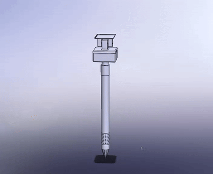
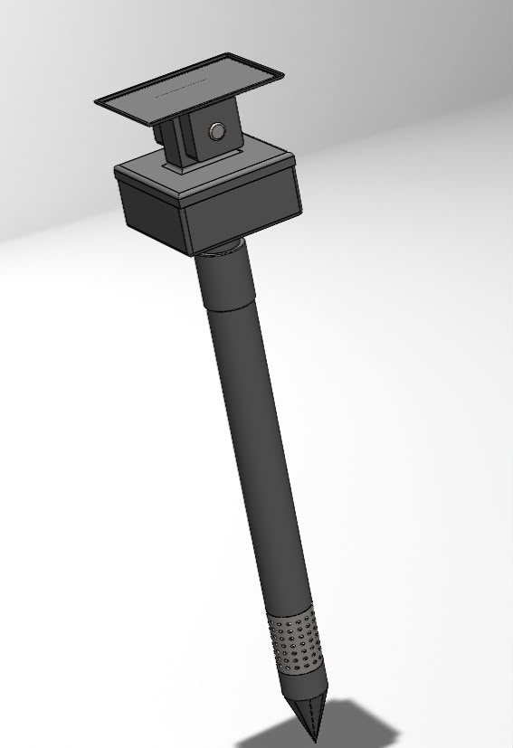
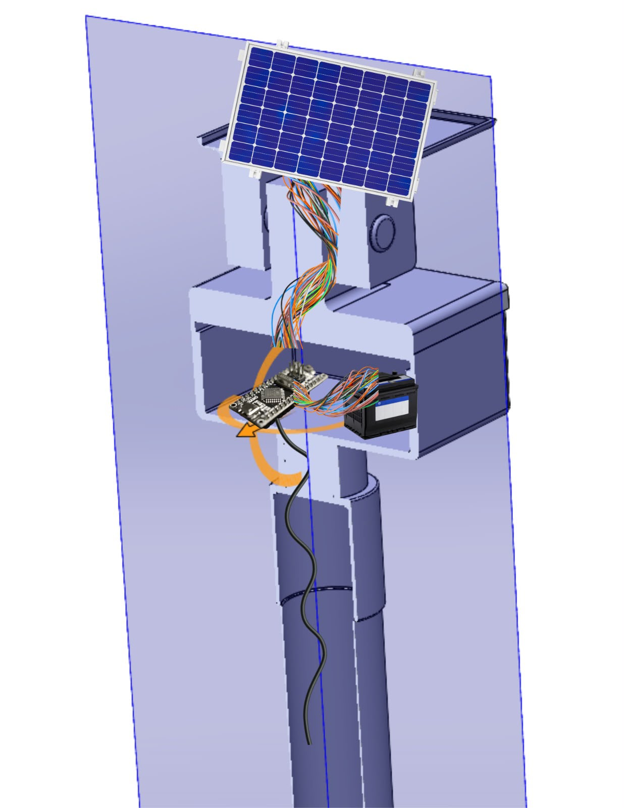
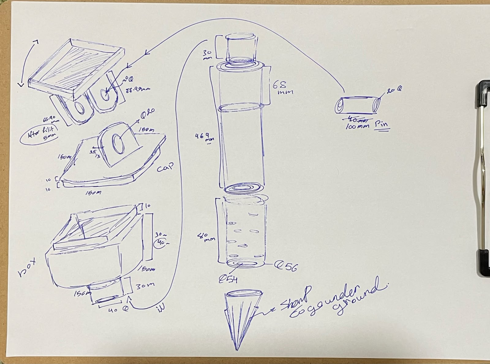
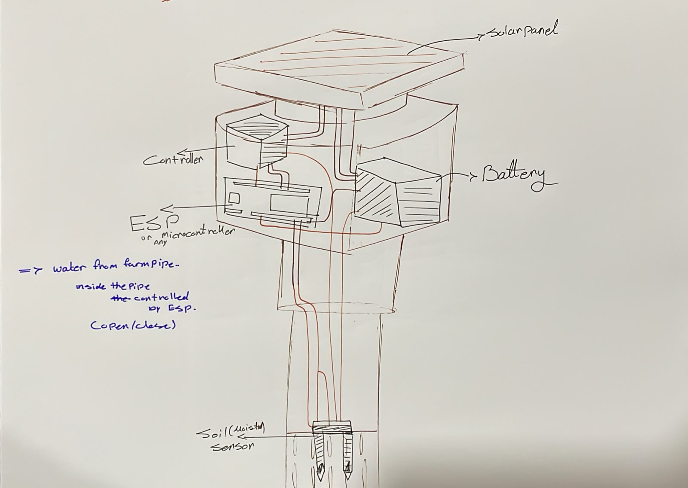

# Liwa Oasis IoT Ground Sensor Node -- Theoretical Firmware Testing Harness & Hardware Prototype

> **Important Engineering Scope & Disclaimer:**  
> This Wokwi simulation is strictly a **theoretical proof-of-concept testing harness** designed to verify the microcontroller firmware logic, state machine transitions, and relay actuation thresholds. It is **explicitly not a full physical simulation** nor close to a real-world soil dynamic simulation. A full physical simulation would require multiphase porous-media soil transport equations, calibrated TDR/FDR dielectric permittivity response curves for hyper-saline desert sands, and hydraulic micro-drip network fluid dynamics. This environment serves solely to validate that the embedded C++ control loop reliably executes threshold decisions before flashing onto physical ESP32 hardware.

---

## 1. Physical Hardware & CAD Mechanical Design

The ground sensing probe is engineered as a field-deployable, self-powered solar station designed for insertion into the date palm root zone in hyper-arid desert sands.

### 3D CAD Turntable Animation (Internal Wiring & Enclosure)


### Physical Assembly & Internal Cutaway
| Full External Assembly | Internal Electronics Cutaway |
| :---: | :---: |
|  |  |

### Engineering Blueprints & Schematics
| Mechanical Dimensions (mm) | Internal Electrical & Plumbing Schematic |
| :---: | :---: |
|  |  |

#### Component Specifications:
- **Upper Housing Enclosure:** IP67-rated 3D-printed enclosure ($150\text{mm} \times 150\text{mm} \times 40\text{mm}$) housing the ESP32 microcontroller, solar charge controller, and rechargeable Li-ion battery pack.
- **Adjustable Solar Roof Bracket:** Tilting monocrystalline PV panel mount ($100\text{mm}$ hinge pin) oriented toward solar zenith in Liwa.
- **Vertical Conduit Shaft:** $469\text{mm}$ cylindrical shaft routing internal wiring safely below surface sand.
- **Subsurface Sensor Cage:** $80\text{mm}$ perforated stainless steel cage ($\varnothing 54\text{mm}$) housing the Soil Moisture and Electrical Conductivity (EC) electrodes.
- **Ground Stake Tip:** Conical tip driving into root zones without disturbing surrounding sand structure.
- **Controllable Solenoid Valve:** Automated valve integrated with drip lateral line, triggered directly by the ESP32 logic.

---

## 2. Firmware Testing Harness (Wokwi Simulation)

### What This Simulates (Firmware & Control Logic Only):
- **ESP32 Microcontroller:** Core controller running the threshold state machine.
- **Subsurface Soil Moisture Input:** Potentiometer emulation mapping 0% to 100% Volumetric Water Content (VWC).
- **Subsurface Salinity Input:** Potentiometer emulation mapping 0 to 12.0 dS/m Electrical Conductivity (EC).
- **0.96" I2C OLED Display:** Real-time in-field visualization of telemetry state and valve status.
- **Solenoid Irrigation Valve Relay & Indicator LED:** Actuates the simulated valve when root-zone moisture drops below 25% (deficit irrigation) or when soil salinity exceeds 4.0 dS/m (leaching requirement).
- **Telemetry Stream:** Serial JSON packets formatted for ground-to-satellite integration.

---

## 3. How to Test in the Browser (Theory Verification)

1. Open your browser and navigate to: **[https://wokwi.com/projects/new/esp32](https://wokwi.com/projects/new/esp32)**
2. In the code tab (`sketch.ino`), select all and paste the contents of [`simulation/sketch.ino`](sketch.ino).
3. In the circuit tab (`diagram.json`), select all and paste the contents of [`simulation/diagram.json`](diagram.json).
4. Click the green **Play** button at the top.
5. In the Library Manager tab (`libraries.txt` in Wokwi), add:
   ```
   Adafruit SSD1306
   Adafruit GFX Library
   ```
6. **Verify the State Machine Behavior:**
   - Turn the **Soil Moisture** dial down below 25%: Observe the OLED display transition to `Valve: ON (DEFICIT)`, the relay trigger, and the green indicator LED illuminate.
   - Turn the **Soil Salinity EC** dial up above 4.0 dS/m: Observe the display transition to `Valve: ON (LEACHING)`.
   - Return both dials to nominal ranges (Moisture 35%, EC 1.5 dS/m): Observe the system return to `Valve: OFF [OPTIMAL]`.
